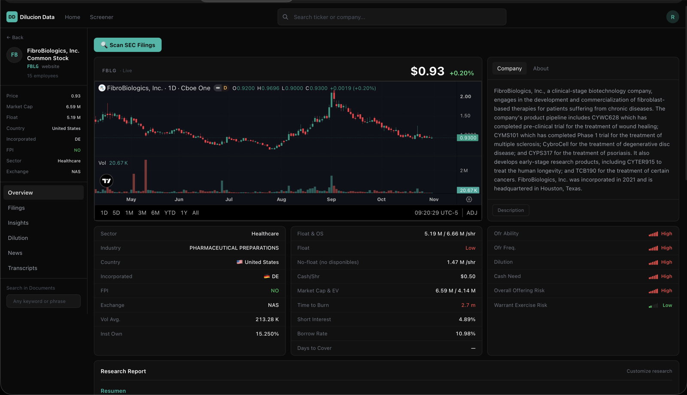
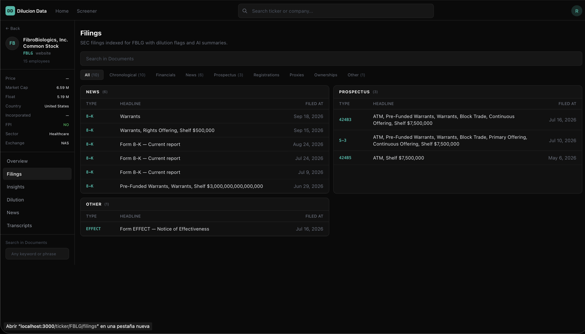
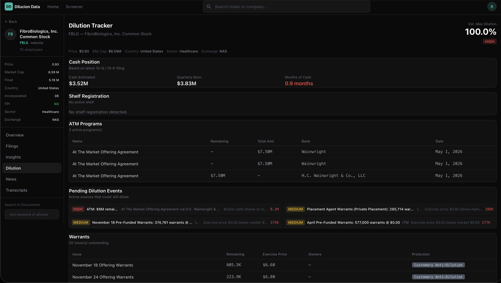
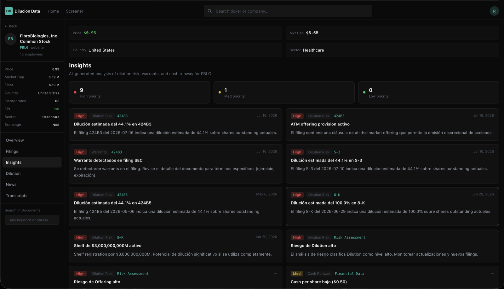

# Dilucion Data 📉🔍

Rastreador de **dilución accionaria** a partir de los filings de la SEC. Detecta eventos de dilución
(warrants, convertibles, ATMs, shelf registrations, equity lines, offerings), calcula su impacto y
riesgo, responde preguntas con IA sobre el texto de los filings y avisa por Telegram — todo desde una
UI web.

> ⚠️ **No es consejo de inversión.** Herramienta de investigación y seguimiento para uso personal.

---

## Características

### Detección de dilución
- Lee **10-K, 10-Q, 8-K, S-1, S-3, 424B** y otros formularios directamente de **SEC EDGAR**.
- Extrae y clasifica: **warrants**, **convertibles**, **programas ATM**, **shelf registrations**,
  **equity lines** y **offerings**.
- Marca los casos especialmente tóxicos: **full ratchet** y **warrants pre-fondeados**.
- Calcula el impacto sobre el capital: acciones nuevas, % de dilución y nivel de riesgo.

### Análisis con IA
- **RAG con citas**: preguntas en lenguaje natural sobre un ticker o un filing concreto, con
  referencias al texto original (LangChain + ChromaDB).
- **Resúmenes y reportes** generados por LLM, en español.
- Proveedor **configurable**: DeepSeek por defecto, pero sirve OpenAI, Groq, Together o un servidor
  local — ver [`docs/CONFIGURACION_IA.md`](docs/CONFIGURACION_IA.md).

### Alertas y vigilancia
- **Bot de Telegram** para alertas de filings críticos.
- **Monitor RSS** de EDGAR con intervalo configurable.
- **Watchlist** de tickers con feed de eventos.

### Contexto de mercado
- **Screener de gaps**: ganadores/perdedores, pre-market y after-market.
- **Halts reales** con su motivo.
- Datos agregados de **Polygon/Massive, Finnhub, Benzinga, EODHD, Stonktracker, Finviz, Yahoo
  Finance** y **Google News**, con rate limiting y caché en SQLite.

### Dos señales propias del proyecto
- **`FPI`** (Foreign Private Issuer): avisa de que los insiders **no presentan Form 3 ni Form 4**, así
  que la pata de distribución del pump-and-dump es invisible. Ver [más abajo](#fpi-y-la-ceguera-del-10-q).
- **`Time to Burn`**: meses de caja disponible según XBRL de EDGAR. Cubre a los emisores que presentan
  20-F, que el tracker de dilución no lee.

---

## Capturas

**Overview** — ficha del ticker: gráfico, float y capital emitido, caja disponible y nivel de riesgo
por factor.



**Filings** — filings indexados de la SEC, agrupados por tipo (news, prospectus, otros) con su
headline y fecha.



**Dilution Tracker** — warrants, programas ATM, shelf registrations, eventos de dilución pendientes y
posición de caja con su quema trimestral.



**Insights** — hallazgos del análisis con IA priorizados por riesgo, enlazados al filing que los
provoca.



---

## Stack

| Capa | Tecnología |
|---|---|
| Backend | Python 3.12+ · **FastAPI** · Uvicorn |
| Frontend | **Next.js** (React) |
| Datos | **SQLite** + **Parquet** (pandas) + **ChromaDB** (vectores) |
| IA | **LangChain** + proveedor compatible con OpenAI (DeepSeek por defecto) |
| Notificaciones | Bot de **Telegram** |
| APIs de mercado | Polygon, Massive, Finnhub, Benzinga, EODHD, Stonktracker, Finviz, yfinance, Google News |

## Estructura

```
backend/
  main.py             # API FastAPI + entry point CLI
  config.py           # Settings (pydantic-settings), lee de .env
  models.py           # Modelos Pydantic del dominio
  dilution_tracker.py # Servicio principal de detección de dilución
  dilution_rag.py     # Extracción RAG de eventos desde filings
  fpi.py              # Clasificación de Foreign Private Issuer
  burn.py             # Pista de caja (Time to Burn) desde XBRL
  data_sanity.py      # Validación de perfiles antes de publicarlos
  pipeline.py         # Pipeline de escaneo por ticker
  screener.py         # Gap screener + halts
  telegram_bot.py     # Bot de alertas de Telegram
  apis/               # Clientes de APIs de mercado (con rate limiting)
  parsers/            # SEC parser + extracción de tablas + cálculo de dilución
  scanners/           # EDGAR index, company facts, EFTS, RSS monitor
  rag/                # Motor RAG (vector store + consultas)
  db/                 # SQLite + Parquet
frontend/             # UI Next.js
data/                 # Datos generados — gitignored, nunca se sube
_meta/SPEC.md         # Especificación técnica
docs/                 # Guía de IA y documentación adicional
```

## Requisitos

- **Python 3.12+**
- **Node.js 18+** (para el frontend)
- Claves de API de las fuentes que quieras usar (ver `.env.example`)

## Arranque rápido

```sh
# 1. Claves
cp backend/.env.example backend/.env
chmod 600 backend/.env          # solo tú puedes leerlo
$EDITOR backend/.env            # pon AL MENOS LLM_API_KEY y OPENAI_API_KEY

# 2. Backend
cd backend
python3 -m venv .venv
.venv/bin/pip install -r requirements.txt
.venv/bin/python main.py db init
.venv/bin/python main.py serve           # http://localhost:8000/docs

# 3. Frontend (otra terminal)
cd frontend
npm install
npm run dev                              # http://localhost:3000
```

O todo de una vez con `./start.command`, que lanza ambos, hace health check y los para al cerrar.

---

## Configuración

Todas las variables viven en **`backend/.env`**, que está en `.gitignore`. La plantilla pública es
`backend/.env.example`, con placeholders.

### IA (obligatorio para RAG)

| Variable | Uso | Defecto |
|---|---|---|
| `LLM_API_KEY` | Clave del modelo de chat | (usa `DEEPSEEK_API_KEY`) |
| `LLM_BASE_URL` | Endpoint compatible con OpenAI | `https://api.deepseek.com/v1` |
| `LLM_MODEL` | Modelo de chat | `deepseek-chat` |
| `LLM_REASONING_MODEL` | Modelo para razonamiento (convertibles) | `deepseek-reasoner` |
| `DEEPSEEK_API_KEY` | Atajo compatible con versiones anteriores | — |
| `OPENAI_API_KEY` | **Embeddings** (obligatorio, van a OpenAI) | — |
| `EMBEDDING_MODEL` | Modelo de embeddings | `text-embedding-3-small` |
| `EMBEDDING_BASE_URL` | Servidor de embeddings alternativo (p. ej. Ollama) | (OpenAI) |

Guía completa con ejemplos para OpenAI, DeepSeek, Groq y Ollama:
**[`docs/CONFIGURACION_IA.md`](docs/CONFIGURACION_IA.md)**.

### Datos de mercado (todas opcionales)

| Variable | Uso |
|---|---|
| `POLYGON_API_KEY` / `MASSIVE_API_KEY` | Cotizaciones, candles y noticias (Massive es el rebrand de Polygon: misma clave) |
| `FINNHUB_API_KEY` | Perfil, quote y noticias (30 req/min) |
| `BENZINGA_API_KEY` | Noticias de mercado |
| `EODHD_API_KEY` | Noticias (free tier ~20 llamadas/día, caché de 6h) |
| `STOCKSERA_API_KEY` | Borrow fee / short interest |

El agregador de noticias usa **todas** las que estén configuradas; si falta una, simplemente no se
consulta.

### Alertas, rutas y servidor

| Variable | Uso |
|---|---|
| `TELEGRAM_BOT_TOKEN` / `TELEGRAM_ADMIN_CHAT_ID` | Alertas por Telegram |
| `SEC_USER_AGENT` | **Obligatorio para EDGAR**: un identificador + tu correo real |
| `DATA_DIR` / `CHROMA_DIR` | Rutas de datos y del vector store |
| `API_HOST` / `API_PORT` | Dónde escucha el backend |
| `FRONTEND_URL` | Origen permitido en CORS |
| `RSS_POLL_INTERVAL_SECONDS` | Frecuencia del monitor RSS (defecto 120) |

---

## Ejecución

### Backend

```sh
cd backend
.venv/bin/python main.py serve     # :8000 por defecto (API_PORT para cambiarlo)
```

Swagger en `http://localhost:8000/docs`.

### Frontend

```sh
cd frontend
npm run dev                        # :3000
```

Apunta al backend vía `NEXT_PUBLIC_BACKEND_URL` (por defecto `http://localhost:8000`).

### CLI

`main.py` expone subcomandos además de `serve`:

```sh
.venv/bin/python main.py db init                    # inicializa la base de datos
.venv/bin/python main.py scan AAPL                  # pipeline completo (filings → dilución)
.venv/bin/python main.py scan SPHL --ask "warrant details?"   # escaneo + pregunta RAG
.venv/bin/python main.py rag AAPL --prompt warrants # consulta RAG por ticker
.venv/bin/python main.py rag <url_filing> --question "..."    # RAG sobre un filing concreto
.venv/bin/python main.py search -q "Full Ratchet"   # búsqueda full-text en EDGAR
.venv/bin/python main.py report                     # reporte de riesgo de dilución
.venv/bin/python main.py monitor                    # monitor RSS de la SEC
.venv/bin/python main.py telegram                   # bot de alertas
```

Lista completa: `.venv/bin/python main.py --help`.

## API (resumen)

| Endpoint | Descripción |
|---|---|
| `GET /health` | Estado del servicio |
| `POST /rag` | Pregunta RAG sobre un ticker/filing (respuestas citadas) |
| `GET /ticker/{ticker}` | Perfil, quote y valoración de riesgo |
| `GET /ticker/{ticker}/dilution` | Análisis completo de dilución |
| `GET /ticker/{ticker}/news` | Noticias agregadas |
| `GET /dilution/top` | Tickers con mayor dilución detectada |
| `GET /alerts/feed` | Feed de alertas |
| `GET /filings/all` | Filings procesados |
| `GET /search` | Búsqueda de tickers |
| `POST /scan/{ticker}` | Escaneo manual de un ticker |
| `GET /screener/gap` | Gap screener (ganadores/perdedores, pre/post-market) |
| `GET /screener/halts` | Halts reales |

---

## Cómo se calcula la dilución

```
S_new = monto_ofrecido / precio_actual
Dilution % = S_new / (acciones_en_circulación + S_new) × 100
```

| Dilución | Nivel |
|---|---|
| ≥ 20% | 🔴 Alto |
| 10 – 20% | 🟡 Medio |
| < 10% | 🟢 Bajo |

## FPI y la ceguera del 10-Q

Un **Foreign Private Issuer** es una sociedad constituida fuera de EE.UU. que cumple los tests de la
Rule 3b-4. Dos consecuencias que afectan de lleno a esta herramienta:

1. **Está exento de la Section 16** (Rule 3a12-3): sus insiders **no presentan Form 3 ni Form 4**. La
   ausencia de esos formularios **no significa que no haya venta de insiders**, significa que no se
   puede ver.
2. **Presenta 20-F, no 10-K/10-Q.** El tracker de dilución solo lee 10-K/10-Q, así que es **ciego** a
   ellos.

Por eso:

- La ficha del ticker marca `FPI: YES` en rojo cuando detecta formularios de la serie F, 20-F, 40-F o
  6-K. Esos formularios solo los puede presentar un FPI, así que su presencia es prueba suficiente.
- `Time to Burn` sale del **XBRL de companyfacts**, que sí cubre a un emisor extranjero. Distingue tres
  casos, y no significan lo mismo:
  - **`X.X m`** — meses de caja al ritmo de quema actual. Rojo por debajo de 6 meses.
  - **`—`** — hay balance y el flujo de operaciones es positivo: no hay quema que agotar.
  - **`s/d`** — EDGAR no devuelve ni caja ni flujo. Es "sin dato", **no** "no quema".

---

## Seguridad y datos

- Las claves viven **solo** en `backend/.env` (gitignored, recomendado `chmod 600`). La plantilla
  pública es `backend/.env.example`, con placeholders.
- **Si haces un fork o una copia, pon tus propias claves.** Las de este repositorio no existen: el
  `.env` real nunca se sube.
- `data/` (SQLite, Parquet, ChromaDB, cachés) está gitignored: aquí vive la operativa real.
- El backend escucha en `127.0.0.1` por defecto. Con `0.0.0.0` queda alcanzable desde toda la LAN
  **sin autenticación**, incluido el proxy de IA.
- Antes de publicar un fork, revisa que no arrastras secretos:
  `git log -p | grep -iE "api_key|token|secret" | head`

## Notas

- Los reportes RAG se generan en **español**.
- Las llamadas a APIs externas tienen **rate limiting** y caché en SQLite (`data/api_cache.sqlite`).
- El primer escaneo de un ticker descarga y procesa sus filings; puede tardar (luego se cachea).
- Los embeddings van a OpenAI por defecto; sin `OPENAI_API_KEY` el RAG no arranca.
